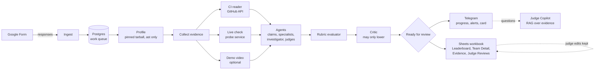

# Architecture

Judgebench turns a hackathon submission (a Google Form response with a GitHub repo, an optional
live URL and an optional demo video) into evidence, claim checks and draft rubric scores. Judges
see the results in Telegram and in a Google Sheets workbook. Humans make every final decision.

## Components

| Component | Code | Role |
|---|---|---|
| API | `api/` | Form ingestion, Sheets publishing, internal endpoints for Scheduler and Pub/Sub |
| Worker | `worker/`, `workflow.py` | Runs the pipeline stages; Postgres is the work queue |
| Probe | `probe/` | The only code that calls participant URLs, through one SSRF-guarded client |
| Agents | `agents/` | Google ADK agents and the code rules around them |
| Telegram | `telegram/` | Notifications (transactional outbox) and the Judge Copilot |
| Google | `google/` | Forms setup, workbook layout, Sheets sync that keeps judge edits |
| Database | `db/` | PostgreSQL 16 with pgvector; Alembic migrations |

Locally everything runs in one process (`judgebench run`). On Cloud Run each component is its own
service with its own service account (see `deploy/README.md`).

## Flow



## Submission state machine

```
RECEIVED → PROFILED → COLLECTING_EVIDENCE → EVALUATING → CRITIQUING → READY_FOR_REVIEW → REVIEWED
                         any stage → FAILED (resumable to its last successful state)
                         budget or policy stop → REQUIRES_HUMAN
```

- Transitions are compare-and-set (`UPDATE … WHERE state = expected`), so duplicate deliveries and
  concurrent workers can't double-process a submission.
- Workers take leases with `FOR UPDATE SKIP LOCKED`; an expired lease lets another worker resume.
- A crash mid-stage resumes that stage only. Evidence is append-only per stage attempt.
- Telegram messages are written to an outbox in the same transaction as the state change, then
  sent and marked; a restart never sends twice.

## Code versus agents

Decisions that must not depend on a model are code. The model writes text inside limits code sets.

| Code (deterministic) | Agents (Google ADK) |
|---|---|
| Repo profiler and adapters (RAG, agentic, ML, generic) | `claim_analyst`: extracts claims from the README and Form |
| CI reader: does a workflow actually run a test runner | `<x>_specialist`: interprets one adapter's findings |
| Live check plan and the latency rule (claim of speed vs measured time) | `claim_investigator`: ReAct loop with read-only tools, budget of 8 tool calls (6 for free-tier runs) |
| Claim status rules (`clamp_verdict`): what evidence each status needs | `claim_judge_2`, `claim_judge_3`: extra votes, only for contested claims |
| Score clamps and critic rules (a high score must cite evidence) | `rubric_evaluator`: criterion scores citing evidence |
| Which specialists run (orchestrator routing from the profile) | `critic`: reviews scores; may lower or flag, never raise |
| Event scope, tools, budgets, rate limits | `copilot`: answers judge questions from stored evidence |

The orchestrator is a custom ADK `BaseAgent`. It runs the matching specialist and the
investigator in parallel, then extra claim judges only when the evidence is mixed or a claim
looks contradicted, then the evaluator. Each contested claim is decided by a majority of three
votes; code clamps every verdict to what the evidence allows.

## Model modes

| `LLM_MODE` | Models | Cost | Use |
|---|---|---|---|
| `offline` (default) | A rule-based fake model; every result is labelled MOCK | $0 | Tests, quickstart, CI |
| `gemini_free` | Gemini API free tier (e.g. `gemini-3.5-flash-lite`) | $0 | Only the six synthetic demo repos; any other repo is refused |
| `vertex` | Gemini on Vertex AI | Billed | Real events |

In `gemini_free` mode a shared rate limiter keeps every request under the free tier's per-minute
limit, counts retries, and fails a team visibly on a daily quota error. It never switches model.

## Retrieval

Evidence, README sections and code are chunked into Postgres. The Copilot and the benchmark use
hybrid search: Postgres full-text rank and pgvector cosine distance, fused with reciprocal rank
fusion. The event filter is inside the ranking SQL, so a judge can only retrieve their own
event's data. Embeddings come from Vertex in `vertex` mode and from a local lexical hashing
embedder (768 dimensions) otherwise.

## Outputs

**Telegram** (compact mode): one progress line per team, edited in place; a separate message for
each contradicted claim, critic revision and failure; a summary card with the score, the thing
that stood out, one question to ask, the Sheet link and the model that produced it.

**Sheets workbook:**

| Tab | Contents |
|---|---|
| Leaderboard | Rank, score, confidence, flags, biggest concern, question to ask, links, model |
| Team Detail | One reason per criterion with clickable evidence (file and line at the pinned commit) |
| Evidence | Every finding with a status: Confirmed, Partly confirmed, Not checkable, Contradicted, Missing |
| Judge Reviews | Judges' own scores and notes; preserved across every re-sync |

Values are written RAW, so participant text can never become a formula.

## Observability

- Every model call is recorded in `agent_runs` and `usage_records` (tokens, latency, cost).
- `judgebench explain <event>` prints claims, votes, checks, critic changes and tool calls.
- `judgebench usage <event>` prints calls, tokens and latency per team and per agent.
- OpenTelemetry spans per stage; exported to Cloud Trace when deployed.

## Repository layout

```
src/judgebench/
  adapters/    profiler, inspectors, static call graph
  agents/      ADK agents, schemas, scoring rules, model modes, offline fake model
  api/         FastAPI app and Form ingestion
  cli/         judgebench command, setup, doctor
  db/          models, scope checks, migrations
  google/      workspace client, workbook layout, Sheets sync
  probe/       SSRF guard and probe service
  telegram/    notifier, compact mode, Copilot
  worker/      GitHub fetch, extraction, CI, live check, stages
benchmark/     labelled demo cast and retrieval queries
deploy/        Dockerfiles and Cloud Run IAM notes
tests/         unit, integration and security tests
```

Design choices and their reasons are in [DECISIONS.md](DECISIONS.md). The security boundary is in
[SECURITY.md](SECURITY.md).
