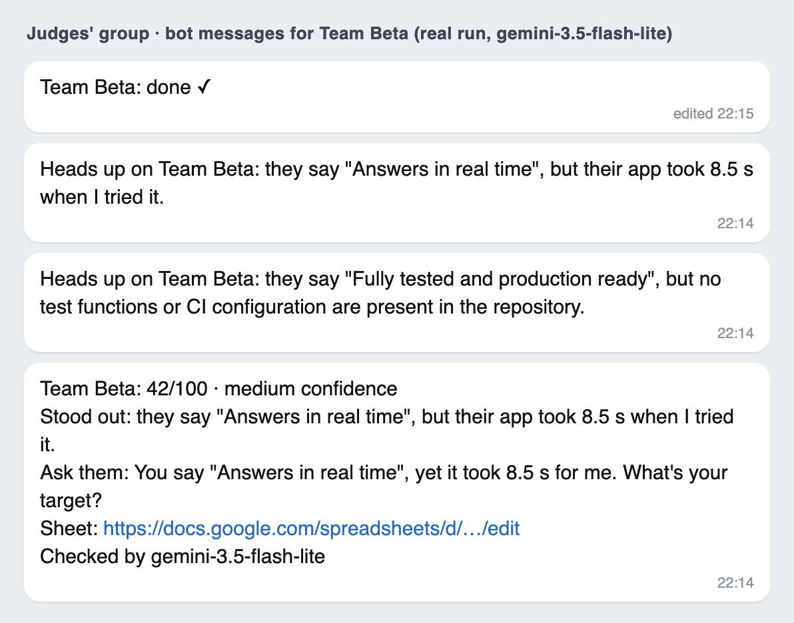
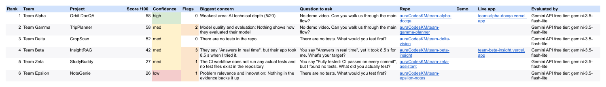
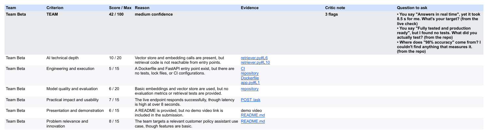
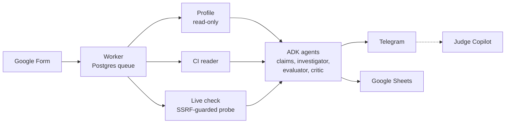

# Judgebench

Not related to the JudgeBench benchmark for LLM judges.

An AI judging agent for hackathons. It reads each submission's code, CI and live app, checks
the team's claims against that evidence, and gives judges a short summary and the question worth
asking.

## The problem

Judges get a few minutes per team and can't read every repository. README claims like "real
time", "98% accuracy" or "fully tested" are easy to write and hard to check on stage. The result
is scoring by presentation rather than by what was built.

## What it does

- Takes submissions from a Google Form (repo, live URL, demo video, sample request).
- Reads the repository at a pinned commit, without running any of it.
- Reads the team's CI: does it actually run tests?
- Calls the live app once with the team's own sample request, through a guarded client.
- Extracts claims from the README and Form, and checks each one against the evidence.
- Drafts rubric scores with a reason and evidence for each criterion; a critic can only lower them.
- Posts progress, contradicted claims and a summary card to the judges' Telegram group.
- Writes a Google Sheets workbook (Leaderboard, Team Detail, Evidence, Judge Reviews) and keeps
  judges' own edits across every update.
- Answers judges' follow-up questions in Telegram from the stored evidence.

Judges make every decision. Scores are drafts.

## Screenshots

All three come from one real run on 20 Nov 2026 with `gemini-3.5-flash-lite`, on the synthetic
demo repositories described in [RESULTS.md](RESULTS.md).



*Telegram, Team Beta. The progress line is edited in place until "done". Beta's README says
"Answers in real time (under 1 second)"; the live check measured 8.5 s. Rendered from the bot's
message log for that run, with the workbook link shortened.*



*Leaderboard. One row per team: score, confidence, flags, the biggest concern and one question,
in plain words. The last column names the model that produced the row.*



*Team Detail, Team Beta. One sentence per criterion; each evidence link opens the file and line
at the pinned commit, or the check that produced it.*

## Architecture



Python 3.12, FastAPI, PostgreSQL with pgvector, Google ADK and Gemini. Deterministic checks and
score rules are code; the models write claims, verdicts, reasons and questions within limits the
code enforces. Details: [ARCHITECTURE.md](ARCHITECTURE.md).

## How it stays safe

| Risk | Defence |
|---|---|
| Malicious repository code | Never run. Tarball of a pinned commit, parsed as text and with `ast.parse` only. No install, build or import |
| Malicious archives | Size, file-count and depth caps; `..`, absolute paths and all links rejected |
| SSRF through the live URL | One client: HTTPS on 443 only, DNS resolved once and pinned, every address checked, redirects re-checked, request and size caps. Runs as a service with no IAM roles |
| Prompt injection in READMEs | Participant text only inside fenced data blocks; tools, scope and score limits set by code; a critic and evidence rules check every score |
| Cross-event access | Scope comes from judge membership; event filter inside the retrieval SQL; denials logged |
| Participant data on a free tier | The free Gemini tier is allowed only for the six synthetic demo repos; any other repo is refused |

Each row is backed by tests in `tests/security/` (52 tests). See [SECURITY.md](SECURITY.md).

## How it's evaluated

| What | Result | Conditions |
|---|---|---|
| Intended claim outcome | 17 of 18 runs | Benchmark: 6 demo repos × 3 runs, 21 Nov 2026, `gemini-3.5-flash-lite` |
| Agent routing and tool trajectory | 18 of 18 runs; trajectory score 1.00 | Same benchmark; ADK `TrajectoryEvaluator` |
| Score spread within a repo | 7 to 14 points of 100 | Same benchmark |
| End-to-end demo event | 6 of 6 teams got the intended result; every judge-facing output check passed | One run through the real Form, Telegram and Sheets, 20 Nov 2026, same model |
| Summary card latency | 136 to 494 s after submission | Same run; free tier under load (44 of 97 requests retried) |
| Beta's "real time" claim contradicted | 9 of 9 runs | 7 runs on `gemini-3.5-flash-lite`, 2 on `gemini-3.1-flash-lite`, 19–21 Nov 2026 |
| Copilot retrieval | Recall@3 0.81, MRR 0.52 | 16 labelled questions; lexical hashing embedder + full-text, no model |
| Model cost | $0 | Gemini API free tier |
| Security boundary tests | 52 of 52 pass | `tests/security/` |

Not yet measured: agreement with human judges (needs a real event) and billed Vertex models.
Full tables and conditions: [RESULTS.md](RESULTS.md).

## Quickstart (offline, $0)

Offline mode uses a rule-based fake model and a local embedder. It makes no model calls and
needs no API keys; every result is labelled MOCK.

```bash
git clone <this repo> && cd judgeBench
uv sync --all-extras
docker compose up -d --wait db
uv run alembic upgrade head
uv run pytest                                    # 262 tests, including the security suite
uv run judgebench bench --runs 1 --only beta     # full pipeline on one demo repo
```

`bench` fetches the public demo repository from GitHub, profiles it, reads its CI, calls its
live app through the guarded client and runs the agent pipeline with the fake model. It prints
retrieval and trajectory metrics. Running a real event needs Google, Telegram and GitHub
credentials: see [M0_SETUP.md](M0_SETUP.md) and [EVENT_RUNBOOK.md](EVENT_RUNBOOK.md).

## Project structure

```
src/judgebench/
  adapters/   repository profiler and inspectors
  agents/     ADK agents, schemas, scoring rules, model modes
  api/        FastAPI app, Form ingestion
  cli/        the judgebench command
  db/         models and migrations
  google/     Forms, Sheets layout and sync
  probe/      SSRF guard and probe service
  telegram/   notifications and Judge Copilot
  worker/     fetch, extraction, CI, live check, pipeline stages
benchmark/    demo cast and labelled retrieval queries
deploy/       Dockerfiles and Cloud Run IAM notes
tests/        unit, integration and security tests
```

## Limitations

- Evaluated on six synthetic repositories only. No agreement with human judges has been measured.
- Scores vary between runs and a lot between models (see RESULTS.md). Treat them as drafts.
- Reads code statically. It can't confirm behaviour it can't observe: training runs, GPU work,
  apps without a live URL or sample request.
- The free tier is slow and rate-limited; under Google's load a team can take several minutes.
- Demo-video review needs a video the model can access; otherwise it is marked not checkable.
- Sheets and Forms use the operator's Google account through OAuth in Testing mode, so the token
  expires after 7 days.

## More

- [ARCHITECTURE.md](ARCHITECTURE.md): components, flow, agents, data
- [RESULTS.md](RESULTS.md): every measured number and its conditions
- [SECURITY.md](SECURITY.md): the security boundary and its tests
- [DECISIONS.md](DECISIONS.md): design choices and why

## License

MIT. See [LICENSE](LICENSE).
